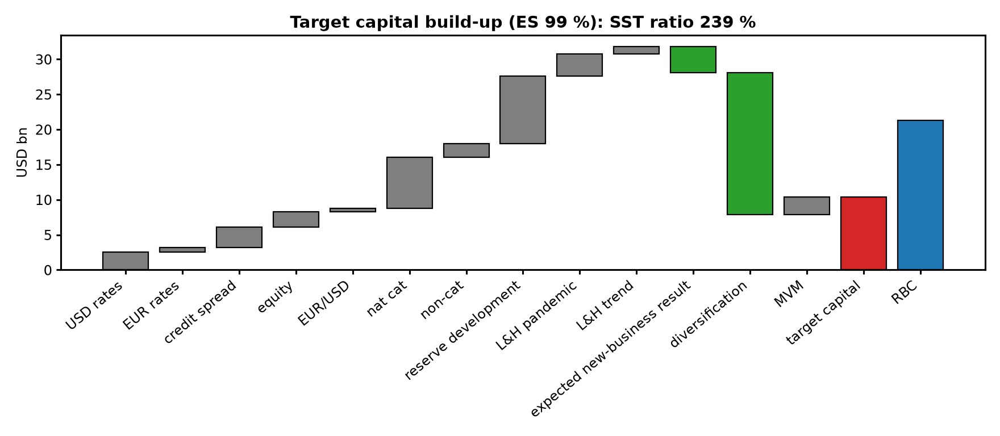
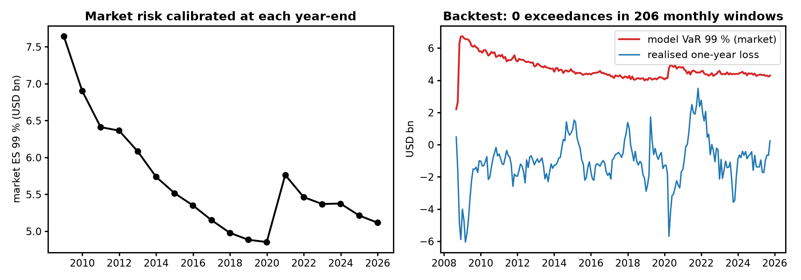

# Swiss Solvency Test (SST) Capital Model for a Stylised Reinsurer

A from-scratch, Python implementation of the logic behind the **Swiss Solvency Test**: a market-consistent
balance sheet, one-year risk measured by **expected shortfall at 99 %**, a cost-of-capital **market value
margin**, and the resulting **SST ratio**, calibrated on 22 years of public market data (2004–2026).
It also produces the reports an SST team prepares: the target-capital build-up, a bridge from book equity to
SST capital, sensitivities, and a backtest of the market-risk model.

> The balance sheet is **illustrative**: sizes are of the order of a large reinsurer (USD bn), but they are
> not any company's reported figures, and the insurance-risk parameters are stated assumptions.
> Market data are real.



## Results (valuation date 12 Oct 2026, `results/summary.json`)

| | USD bn |
|---|---|
| Assets (market value) | 96.0 |
| Best-estimate liabilities (P&C USD/EUR reserves, L&H) | 74.7 |
| **Risk-bearing capital (RBC)** | **21.3** |
| One-year ES 99 %: market 5.1, insurance 7.5, **total 7.8** (net of the expected new-business result, 3.7) | 7.8 |
| Market value margin (6 % cost of capital on run-off capital) | 2.6 |
| **Target capital = ES + MVM** | **10.4** |
| **SST ratio = (RBC − MVM) / (TC − MVM)** | **239 %** (± 1.8 % Monte Carlo, 10 seeds) |

- **Largest risks.** Stand-alone ES: reserve development 9.6, nat cat 7.3 (North Atlantic hurricane dominates),
  credit spreads 3.0, USD rates 2.5, equity 2.1. The ten stand-alone ES values add up to 31.8; the total is
  7.8 because the risks are simulated independently (diversification 20.3) and the one-year result includes
  the expected profit on new business (3.7), as the SST one-year view does.
- **Sensitivities** (`fig5`): rates −100 bp → 258 %, +100 bp → 221 %; spreads +100 bp → 224 %;
  equities −30 % → 216 %; EUR/USD −15 % → 234 %; a 1-in-200 hurricane (USD 7.3 bn) → 146 %.
  Assets are longer than liabilities here, so falling rates *raise* the ratio.
- **Bridge** (`fig4`): book equity 19.9 (liabilities at 5-year-average rates) − intangibles 3.0 + liabilities
  at today's higher rates 4.4 − MVM 2.6 = 18.7 = RBC − MVM. The bridge closes to machine precision.

## Model

| Part | What is done |
|---|---|
| Curves | USD zero curve bootstrapped from Treasury par yields (FRED); EUR AAA zero curve (ECB); BBB spread proxy Moody's Baa − 10y (FRED); S&P 500 and EUR/USD (Yahoo Finance) |
| Balance sheet | Bond ladders that price exactly to market value on the valuation curve; P&C reserves with a 3.5-year payout, L&H with an 11-year payout; every line is a vector of annual cash flows |
| Market risk | One-year scenarios: block bootstrap (25-day blocks) of daily factor changes since 2004, keeping cross-factor correlation and volatility clusters; 200,000 scenarios, each with **full revaluation** of every cash flow |
| Insurance risk | Nat cat: five perils, Poisson frequency × capped Pareto severity; non-cat premium risk; lognormal reserve risk (CV 6 %); L&H pandemic (1-in-100, 8 % shock) and trend risk |
| Capital | ES 99 % of the one-year change in RBC; MVM by cost of capital (6 %) on the run-off of insurance capital; SST ratio as defined by FINMA |

Simplifications, stated honestly: instantaneous shocks (no roll-down or expected investment return over the
year), market and insurance risk independent, no CHF block (the SNB yield feed ended in 2025), no
reinsurance purchased or credit risk on counterparties, constant intangibles.

## Verification

| Check | Result |
|---|---|
| Bootstrapped curve reprices every par bond | error 10⁻¹³ (tests) |
| Bond ladders price to their stated market value | 4 × 10⁻¹⁵ |
| Balance-sheet identity RBC = assets − BEL in every scenario | exact (0.0) |
| DV01: full revaluation vs analytic Σ t·CF·DF | 0.03 % (second-order term) |
| ES estimator vs closed form (normal, Student-t ν = 4) | 2.661 vs 2.665; 5.215 vs 5.221 |
| Simulated nat-cat mean vs exact capped-Pareto mean | 1.093 vs 1.088 (s.e. 0.003) |
| SST ratio Monte Carlo noise (10 seeds) | 238.9 % ± 1.8 % |
| Market ES: block bootstrap vs all overlapping historical years | 5.09 vs 5.47 |
| MVM formula on a one-year liability | exact (test) |
| Book → SST bridge closure | 0.0 |

**Backtest of the market-risk VaR 99 %** (`fig6`): at each month from Sept 2008 to Sept 2025, the model is
calibrated only on data up to that month, then the realised one-year loss of that month's balance sheet is
compared with its VaR. **0 exceedances in 206 windows** (2.1 expected if windows were independent). The windows
overlap, so there are only about 17 independent years, for which 0.2 exceedances are expected: the result is
consistent with a well-calibrated or slightly conservative model, and the naive Kupiec test (p = 0.04) is not
valid for overlapping windows. The worst realised loss was USD 3.5 bn (Nov 2021 → Nov 2022, the rate shock),
below its VaR of 4.5 bn.



## Run

```bash
pip install -r requirements.txt
python scripts/download_data.py   # FRED, ECB, Yahoo Finance into data/
python -m pytest -q tests         # 10 tests, ~3 s
python scripts/run_sst.py         # full study, ~2.5 min: results/summary.json, figures/
```

## Files

| File | Content |
|---|---|
| `src/sst/data.py` | Data loading, USD par-yield bootstrap, EUR zero curve |
| `src/sst/balance_sheet.py` | Cash-flow balance sheet and market-consistent valuation |
| `src/sst/risk.py` | ES/VaR, block bootstrap, nat-cat and insurance simulation, MVM, SST ratio |
| `src/sst/model.py` | Full SST run, factor attribution, book-to-SST bridge |
| `scripts/run_sst.py` | Study, verification, sensitivities, backtest, figures |
| `fig1_curves` … `fig6_history_backtest` | Curves, result distribution, capital build-up, bridge, sensitivities, history and backtest |
